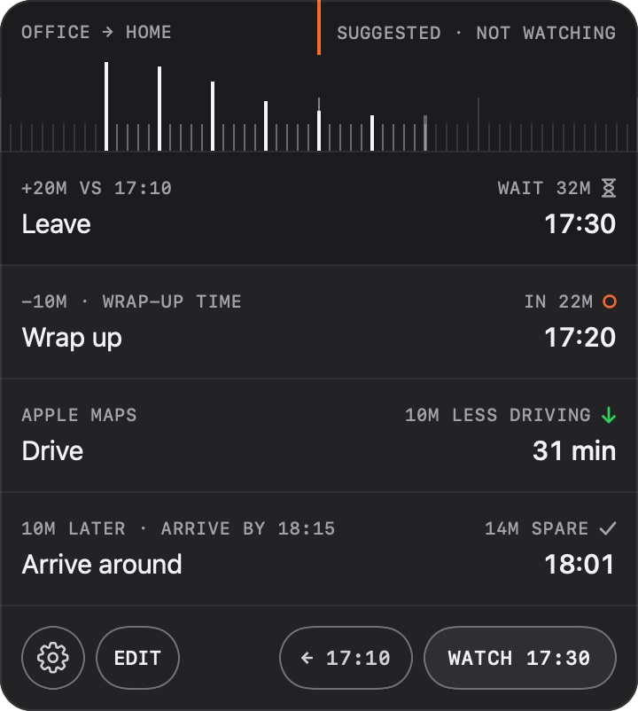
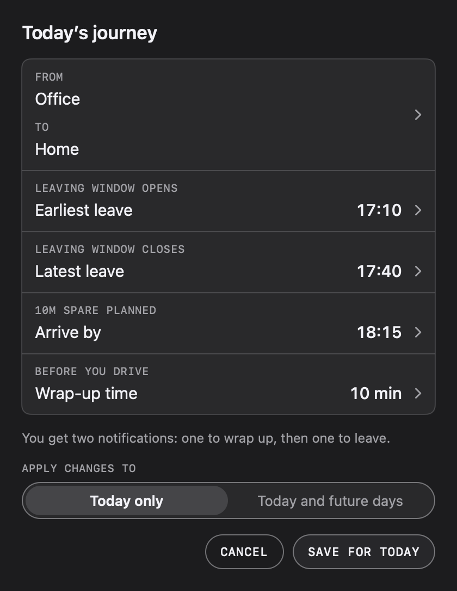
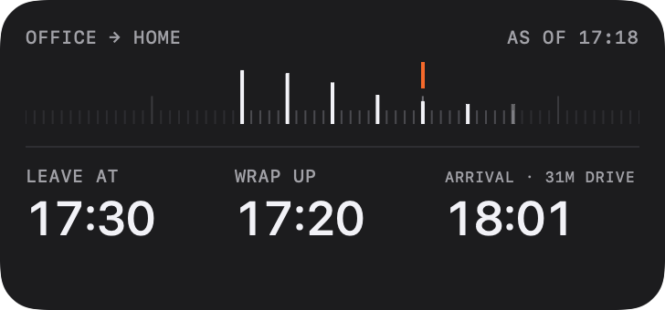

# Window

Window is a Mac menu bar app for the drive home. You tell it when you can leave, when you need to arrive and how long you need to wrap up. It asks Apple Maps how long the drive takes at several departure times in that window and suggests when to leave. Once you pick a time, it watches traffic and tells you when to wrap up and when to go.

<p>
  
  
</p>
<p>
  
</p>

The screenshots use test data, not real places.

## What it does

- Each bar in the panel is one drive-time estimate from Apple Maps. Taller bars mean longer drives. Drag across the ruler, or use the arrow keys, to compare departures.
- The panel shows when to leave, when to start wrapping up, the expected drive and the approximate arrival.
- Choose Watch to commit to a time. While the watch runs, Window rechecks traffic every three minutes and sends two notifications: one to wrap up, then one to leave.
- A small or medium desktop widget shows the last checked plan. It needs a build signed with an Apple developer team, so it isn't in the website download.

Window only works while your Mac is awake and online. It does not schedule alerts in advance and has no server, so if the Mac sleeps, the watch pauses until it wakes.

## How the suggestion works

Window checks up to nine departure times spread evenly across your leaving window, plus a few exact times such as the one you are already watching. It only considers departures you can still make after your wrap-up time and that arrive by your deadline.

- If no departure saves at least 8 minutes of driving compared with the earliest one, Window suggests the earliest.
- Otherwise it suggests the earliest departure whose drive is within 2 minutes of the shortest drive it found, and that saves at least 8 minutes.

So Window only asks you to wait when waiting saves real driving, and it doesn't make you wait longer for a drive that is only a minute or two shorter. These thresholds are product choices, not statistics. Window never makes up an estimate for a time it didn't check. The logic is in `DeparturePolicy.meaningfulDriving` in `EveningCore.swift`.

## Install

Download Window from the [Window website](https://raisul.xyz/window) or the [latest release](https://github.com/raisulchowdhury/window/releases/latest), unzip it and move it to Applications. This version isn't notarized by Apple, so the first time you open it macOS shows a warning, and you allow it once in System Settings > Privacy & Security > Open Anyway.

[INSTALL.md](INSTALL.md) walks through every step, explains the warning, and shows how to check the download's SHA-256 checksum and how to uninstall. The SHA-256 of `Window-1.0.1.zip` is `edc8cad1969fd2bd1333f2410b669d32107e0e90ef5ac8b3fff86fbcd45d6a24`.

To make the same download yourself, run `zsh scripts/package-download.sh` on a Mac with Xcode. It builds a Release app signed ad hoc (no Apple account needed) and writes `dist/Window-<version>.zip` with a `.sha256` file next to it.

## Requirements to build

- macOS 26 or later
- Xcode 26 or later
- [XcodeGen](https://github.com/yonaskolb/XcodeGen) (`brew install xcodegen`)

## Build from source

```sh
# from the repository folder
cp Config/Local.xcconfig.example Config/Local.xcconfig
```

Edit `Config/Local.xcconfig`:

- `DEVELOPMENT_TEAM`: your Apple team ID, from developer.apple.com/account under Membership details.
- `WINDOW_BUNDLE_PREFIX`: your own reverse-DNS prefix, such as `com.yourname.window`. Without it, the bundle IDs start with `com.example.window`. The download on the website uses `xyz.raisul.window`; keep yours different so your build doesn't share its settings.

Then build:

```sh
xcodegen generate
open Window.xcodeproj     # or: ./scripts/build-app.sh
```

`./scripts/build-app.sh` prints the path of the built `Window.app`. Open it, then add Window from the macOS widget gallery.

If you leave `DEVELOPMENT_TEAM` empty, the app still builds and runs, signed to run locally. The widget then can't read the app's shared data and shows "Open Window" instead of the plan.

## Privacy

Your places and times stay on your Mac. Place searches and the coordinates of your two route points go to Apple Maps to look up places and drive times. Window has no account, no analytics and no server, and it doesn't ask for your location.

## Tests

The departure policy, ruler, widget model and watch logic run without a Mac:

```sh
sh scripts/test-linux.sh    # needs Docker
```

On a Mac, run the full suite with `xcodebuild -scheme Window -destination 'platform=macOS' test` after `xcodegen generate`. See [CONTRIBUTING.md](CONTRIBUTING.md).

## License

See [LICENSE](LICENSE).
